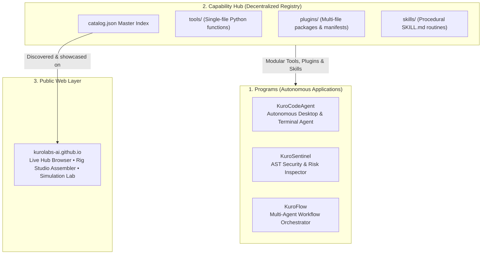

<div align="center">


# ⚡ KUROLABS AI

### _Autonomous Intelligence • Local-First Architecture • Decentralized Ecosystems_

[](https://github.com/kurolabs-ai)
[](https://kurolabs-ai.github.io/)
[](https://github.com/kurolabs-ai/hub)
[](https://github.com/kurolabs-ai/KuroCodeAgent)
[](LICENSE)

<br/>

> **"We build AI agents with hands."**  
> KuroLabs AI develops deterministic, local-first autonomous software agents that plan, compile code, execute shell operations, self-heal runtime failures, and hot-load modular capabilities on demand — all while keeping credentials and telemetry strictly on your machine.

<br/>

[Explore Web Portal](https://kurolabs-ai.github.io/) • [Architecture](#-ecosystem-architecture) • [Active Projects](#-project-ecosystem) • [Engineering Tenets](#-core-engineering-tenets) • [Roadmap](#-strategic-roadmap) • [Community](#-community--contributions)

</div>

---

## 🌐 Vision & Mission

Most modern AI solutions stop at conversational text generation. **KuroLabs AI** bridges the gap between passive language models and active execution environments:

- **Local-First & Sovereign**: Intelligence running in your personal workspace, using OS-level encrypted vaults (Windows DPAPI / AES) with zero external credential leakage.
- **Deterministic Action**: Every proposed change is rigorously checked through AST static analysis, syntax compilation (`py_compile`), and exit-code validation before execution.
- **Resilient & Self-Repairing**: Autonomous diagnosis loops that detect missing libraries, syntax defects, or rate limits and repair them on the fly.
- **Composable Extensibility**: A decentralized architecture that decouples core runtime logic from domain-specific tools and procedural routines.

---

## 🏛️ Ecosystem Architecture

The KuroLabs ecosystem is organized into modular, interconnected layers:



### 1. Programs (Autonomous Applications)

Self-contained, production-grade applications that solve engineering workflows. KuroLabs programs run locally, integrate directly with operating system APIs, and feature native terminal and GUI interfaces.

### 2. Hub (Decentralized Capability Registry)

An open, version-controlled GitHub repository (`kurolabs-ai/hub`) acting as a decentralized marketplace. Developers across the globe contribute standalone tools, procedural skills, and plugins through pull requests to `catalog.json`.

---

## 🚀 Project Ecosystem

### 💻 [`KuroCodeAgent`](https://github.com/kurolabs-ai/KuroCodeAgent) — _Flagship Autonomous Terminal Assistant_

The flagship autonomous coding agent and operating system copilot engineered for developers who demand full control over their development environment.

- **ReAct 2.0 Loop**: Deconstructs high-level objectives into structured multi-step plans with deterministic post-action verification.
- **Provider Resilience**: Automatic zero-downtime cascading across Gemini, Groq, OpenRouter, OpenAI, and local Ollama instances with active API key pool rotation.
- **Self-Healing Diagnostics**: Automatically categorizes runtime tracebacks across 10 distinct failure patterns, resolving issues via automated pip installations, directory reconstruction, or checkpoint rollbacks.
- **Multimodal OS Perception**: Inspects monitors via screenshot vision, operates browsers with headless Playwright, streams live hardware telemetry, and bridges to Discord, Telegram, GitHub, and GitLab.
- **Portable Distribution**: Compiles to standalone console binaries with zero required Python runtime on the host machine.

```bash
# Clone and launch KuroCode
git clone https://github.com/kurolabs-ai/KuroCodeAgent.git
cd KuroCodeAgent
pip install -e .
kuro
```

---

### 🧩 [`hub`](https://github.com/kurolabs-ai/hub) — _Decentralized Capability Registry_

The open community catalog hosting plug-and-play extensions ("puzzle pieces") for KuroCode agents.

| Section          | Role                                          | Examples in Catalog                                              |
| :--------------- | :-------------------------------------------- | :--------------------------------------------------------------- |
| **`tools/`**     | Standalone deterministic Python functions     | `regex_tester.py`, `hash_calculator.py`, `currency_converter.py` |
| **`plugins/`**   | Multi-file modular extensions with manifest   | `code_metrics/`, `dependency_guard/`                             |
| **`skills/`**    | Procedural step-by-step routines (`SKILL.md`) | `tdd_refactoring/`, `security_audit/`                            |
| **Integrations** | Declarative connectors for external platforms | `gitlab`, `slack`, `google_drive`                                |

Direct terminal management inside KuroCode:

```bash
/store update                # Fetch latest catalog.json from GitHub
/store search security       # Query tools and skills by keyword
/store install regex_tester  # Download, AST-verify, and load capability
```

---

### 🌐 [`kuroLabs-ai.github.io`](https://github.com/kurolabs-ai/kuroLabs-ai.github.io) — _Official Web Portal & Interactive Lab_

The public web portal and ecosystem explorer deployed live to [kurolabs-ai.github.io](https://kurolabs-ai.github.io/).

- **Live Capability Explorer**: Search and filter community capabilities fetched directly from `kurolabs-ai/hub`.
- **Rig Studio**: Interactive web assembler to configure agent models, capabilities, and security boundaries with instant JSON export.
- **Simulation Lab**: In-browser sandbox environment simulating multi-step autonomous agent runs and healing cycles.
- **Lightweight Architecture**: Zero-bundler stack crafted with semantic HTML5, Tailwind CSS, custom design tokens, and native ES modules.

---

## 🔒 Core Engineering Tenets

```
┌────────────────────────────────────────────────────────────────────────┐
│                      KUROLABS SECURITY & RELIABILITY                   │
├────────────────────────────────────────────────────────────────────────┤
│  🛡️  Zero-Telemetry Local Vault                                        │
│      OS-native Windows DPAPI / CryptProtectData encryption ensures     │
│      API credentials never exist in plaintext or leak to external logs.│
│                                                                        │
│  🛡️  Pre-Execution AST Guardrails                                      │
│      Static Abstract Syntax Tree inspection prevents hazardous calls,   │
│      banned system imports, and destructive shell execution strings.   │
│                                                                        │
│  🛡️  Deterministic Verification Gates                                  │
│      Every file modification is verified with AST compiler checks      │
│      and paired with automated Git stash checkpoints for instant /undo.│
│                                                                        │
│  🛡️  Decoupled Modularity                                              │
│      Core agent engines remain minimal; domain features are isolated   │
│      into standalone, audited puzzle pieces on the Capability Hub.     │
└────────────────────────────────────────────────────────────────────────┘
```

---

## 🗺️ Strategic Roadmap

Tracking active development across KuroLabs programs and registries:

- [x] **KuroCode Core Release (v0.2.0)**: ReAct 2.0 loop, multi-model cascading, DPAPI vault, SQLite episodic memory, and Store client.
- [x] **Decentralized Capability Hub**: Standardized schema (`catalog.json`), hot-loading pipeline, and community tools/plugins/skills registry.

---

## 🤝 Community & Contributions

The KuroLabs ecosystem thrives on open collaboration. Whether you are creating a new diagnostic tool, packaging an automation skill, or optimizing agent execution logic, your contributions are welcome:

- **Submit a Capability**: Author a tool or workflow and open a PR against [`kurolabs-ai/hub`](https://github.com/kurolabs-ai/hub).
- **Core Agent Contributions**: Submit issues and pull requests to [`kurolabs-ai/KuroCodeAgent`](https://github.com/kurolabs-ai/KuroCodeAgent).
- **Portal Improvements**: Help enhance our web portal and developer documentation at [`kurolabs-ai/kuroLabs-ai.github.io`](https://github.com/kurolabs-ai/kuroLabs-ai.github.io).

---

<div align="center">

### ⚡ KuroLabs AI

_Building the Future of Autonomous, Local-First Software Engineering_

[Web Portal](https://kurolabs-ai.github.io/) • [GitHub Organization](https://github.com/kurolabs-ai) • [Capability Hub](https://github.com/kurolabs-ai/hub)

_Maintained by KuroLabs AI • Open-Source under the MIT License_

</div>
