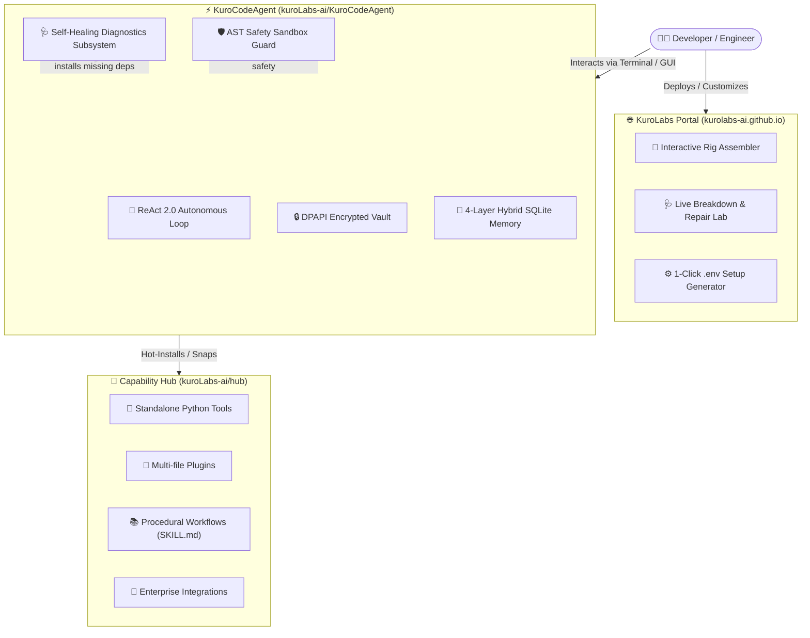

<div align="center">


# ⚡ KuroLabs AI
### *Autonomous System Intelligence • Self-Healing Software • Modular Agentic Ecosystems*

[](https://github.com/kuroLabs-ai)
[](https://kurolabs-ai.github.io)
[](https://opensource.org/licenses/MIT)
[](https://github.com/kuroLabs-ai/KuroCodeAgent)
[](https://github.com/kuroLabs-ai/hub)
[](https://github.com/kuroLabs-ai/KuroCodeAgent)

---

**Architecting the open foundation for autonomous software engineering, verifiable runtime safety, and modular plug-and-play machine intelligence.**

[**Explore Portal**](https://kurolabs-ai.github.io) • [**KuroCode Agent**](https://github.com/kuroLabs-ai/KuroCodeAgent) • [**Capability Hub**](https://github.com/kuroLabs-ai/hub) • [**Documentation**](https://github.com/kuroLabs-ai/KuroCodeAgent#readme)

</div>

---

## 🌌 About KuroLabs AI

**KuroLabs AI** is an open-source research and engineering collective dedicated to building **Level 2+ autonomous software systems**. 

Traditional AI assistants are passive conversational interfaces trapped in the browser. KuroLabs develops local-first, proactive agents capable of diagnosing their own execution errors, safeguarding operating system integrity, and evolving capabilities on the fly without human hand-holding.

### 🏛️ Engineering Pillars

| Pillar | Philosophy | Implementation |
| :--- | :--- | :--- |
| 🛡️ **Zero-Trust Safety** | Agents must never execute destructive code blindly. | Pre-execution **AST Syntax Inspector** intercepts dangerous syscalls, file wipes, and token anomalies before kernel execution. |
| 🩺 **Autonomous Healing** | Runtime crashes should self-correct without user interruption. | Dedicated diagnosis loop with traceback parsing, sandboxed `pip` dependency resolution, and atomic **Git Checkpoint rollbacks**. |
| 🧩 **Puzzle-Piece Modularity** | Tools and skills should be modular components, not monolithic code. | **Capability Market**: Decentralized registry where tools, plugins, skills, and integrations snap into agents hot at runtime. |
| 🔒 **Local Data Sovereignty** | Your code and credentials belong to your hardware. | Encrypted **Windows DPAPI / Keyring Vaults**, offline local model orchestration via Ollama, and zero telemetry collection. |

---

## 🚀 The KuroLabs Ecosystem



---

## 📦 Core Repositories & Programs

### 1. [⚡ KuroCodeAgent](https://github.com/kuroLabs-ai/KuroCodeAgent)
*The Flagship Local-First Autonomous System Engineer & Coding Companion.*
- **Autonomous Evolution**: Generates and compiles its own tools when faced with new tasks.
- **Multi-Model Router**: Seamless failover between **Google Gemini**, **Groq (Llama-3)**, **Ollama (100% Offline)**, and **OpenRouter**.
- **AST Execution Guard**: Strict AST parsing blocks banned operations (`rmdir /s`, disk formatters, arbitrary token abuse).
- **Encrypted Credential Vault**: Secures API tokens using OS-native hardware DPAPI encryption.

### 2. [🧩 Capability Hub (`hub`)](https://github.com/kuroLabs-ai/hub)
*The Decentralized Registry for Plug-and-Play Capabilities.*
- **Clean File Separation**: Metadata resides in `catalog.json`; source code lives in standalone files (`tools/*.py`, `plugins/*/`, `skills/*/SKILL.md`).
- **Zero-Restart Hot Reloading**: Snapping a tool or skill activates immediately inside active agent sessions.
- **Branch-Aware Resolution**: Supports fetching from GitHub `main`, dev branches, or local offline worktrees.

### 3. [🌐 Organization Web Portal (`kuroLabs-ai.github.io`)](https://kurolabs-ai.github.io)
*Next-Gen Developer Interface & Interactive Laboratory.*
- **100% Vanilla Tech Stack**: Pure HTML5, CSS3, and ES6 JavaScript with zero npm build dependencies.
- **Agent Rig Assembler**: Interactive sandbox to snap pieces into runtime slots and generate custom CLI launch commands.
- **Live Self-Healing Simulator**: Visual step-by-step breakdown and recovery animation.
- **Web Audio Synthesizer**: Zero-footprint mathematical procedural sound generator.

---

## ⚡ Quickstart

Install and launch the flagship agent in under 60 seconds:

```bash
# 1. Clone the agent repository
git clone https://github.com/kuroLabs-ai/KuroCodeAgent.git
cd KuroCodeAgent

# 2. Setup your virtual environment
python -m venv venv
# On Windows:
.\venv\Scripts\activate
# On Linux/macOS:
source venv/bin/activate

# 3. Install in development mode
pip install -e .

# 4. Launch KuroCode
kuro
```

### 🧩 1-Click Capability Snapping

Inside the KuroCode interactive terminal, install capabilities from the official Hub on the fly:

```text
kuro > /store list
kuro > /store install json_inspector
kuro > /store install tdd_refactoring
kuro > /heal status
```

---

## 🤝 Contributing to KuroLabs

We welcome contributors from all backgrounds! You can help expand the ecosystem by:

1. **Submitting a New Puzzle Piece**: Add a tool, plugin, skill, or integration to [kuroLabs-ai/hub](https://github.com/kuroLabs-ai/hub) via Pull Request.
2. **Improving Core Autonomy**: Contribute patches, new diagnostic rules, or model adapters to [kuroLabs-ai/KuroCodeAgent](https://github.com/kuroLabs-ai/KuroCodeAgent).
3. **Enhancing Web Labs**: Build new interactive visualizers on [kuroLabs-ai/kurolabs-ai.github.io](https://kurolabs-ai.github.io).

Please review our [Contribution Guide](https://github.com/kuroLabs-ai/hub#contributing-a-new-puzzle-piece) before submitting Pull Requests.

---

## 🔒 Security & Safe Autonomy

KuroLabs AI enforces a **Safe Autonomy Mandate**:
- All code modifications trigger automatic **Git Checkpoint commits** for 1-click atomic undo.
- Destructive commands (`rm`, `format`, `del /f`) require explicit user confirmation unless overridden in developer mode.
- Report any vulnerability directly via [GitHub Security Advisories](https://github.com/kuroLabs-ai/KuroCodeAgent/security).

---

<div align="center">

### 🌐 Connect With KuroLabs AI

[](https://github.com/kuroLabs-ai)
[](https://kurolabs-ai.github.io)
[](https://github.com/kuroLabs-ai/KuroCodeAgent/issues)

*Maintained with 💜 by KuroLabs AI & the Open-Source Community.*

</div>
